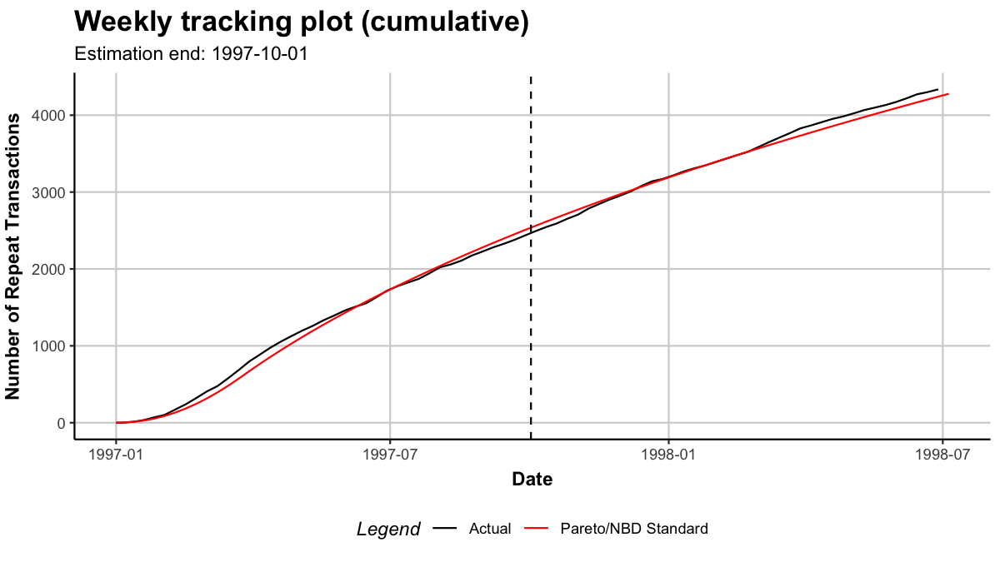
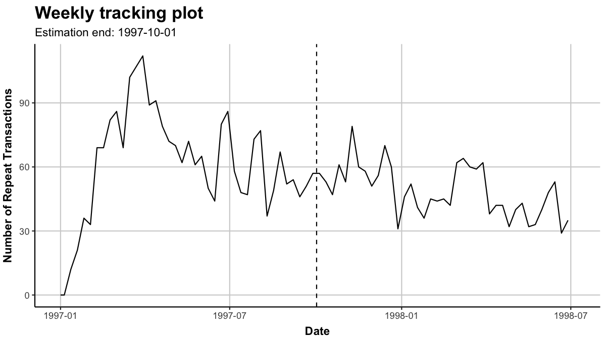
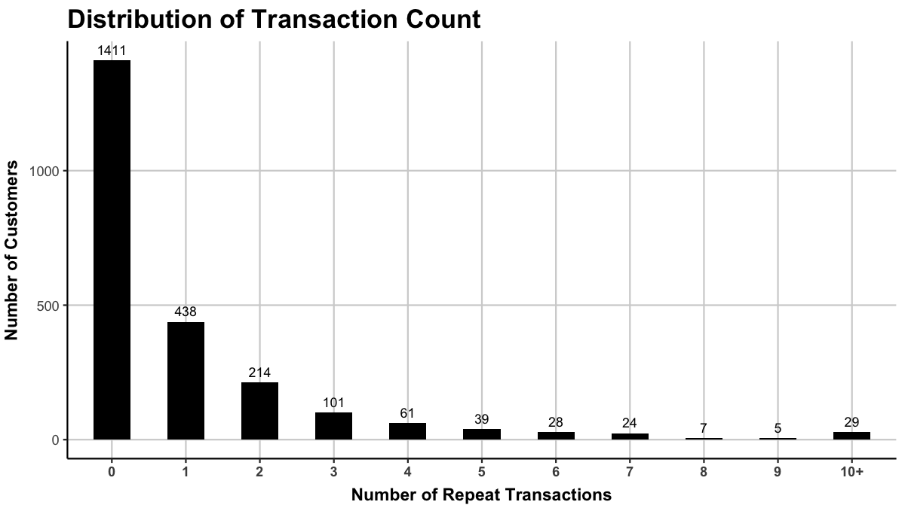
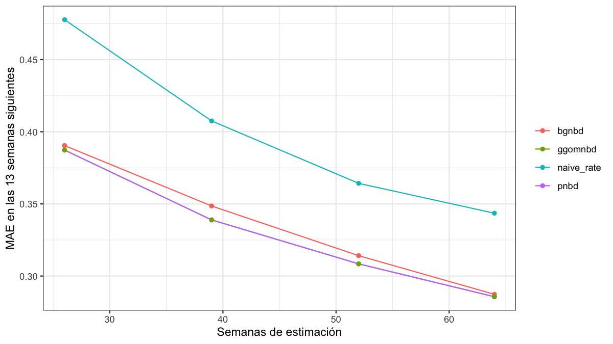
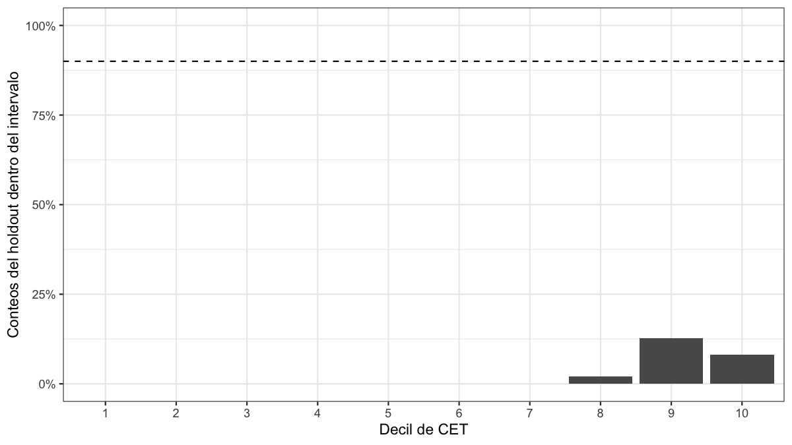

```{r}
#| include: false
proj <- if (file.exists("renv/activate.R")) "." else ".."
source(file.path(proj, "renv/activate.R"))
knitr::opts_knit$set(root.dir = normalizePath(proj))
proj <- normalizePath(proj)

suppressPackageStartupMessages({
  library(data.table)
  library(ggplot2)
  library(knitr)
})
suppressWarnings(source(file.path(proj, "R/00_utils.R")))

tab <- function(name) fread(file.path(proj, "outputs/tables", name))
fit <- tab("02_model_comparison.csv")
hold <- tab("03_holdout_metrics.csv")
cal <- tab("03_calibration_pnbd_deciles.csv")
disc <- tab("04_sensitivity_discount.csv")
hor <- tab("04_sensitivity_horizon.csv")
bench <- tab("05_benchmark.csv")
roll <- tab("08_rolling_origin.csv")
roll_sum <- tab("08_rolling_origin_summary.csv")
cet_sum <- tab("09_cet_uncertainty_summary.csv")
cet_dec <- tab("09_cet_coverage_by_decile.csv")
clv_sum <- tab("09_clv_uncertainty_summary.csv")
rec <- tab("07_parameter_recovery.csv")
cov <- tab("06_covariates_comparison.csv")
clv <- tab("04_clv_pnbd_52w.csv")

setorder(clv, -predicted.CLV)
top_n <- ceiling(nrow(clv) * 0.10)
top_share <- sum(head(clv$predicted.CLV, top_n)) / sum(clv$predicted.CLV)

d <- load_cdnow_clv()
tx <- copy(d$tx)[, Date := lubridate::ymd(Date)]
split_date <- min(tx$Date) + EST_SPLIT_WEEKS * 7
cust <- tx[Date <= split_date, .(n = .N, mean_spend = mean(Price)), by = Id][n >= 2]
rho <- cor(cust$n, cust$mean_spend, method = "spearman")

mae_pnbd <- hold[model == "pnbd", MAE]
mae_bg <- hold[model == "bgnbd", MAE]
mae_naive <- hold[model == "naive_rate", MAE]
mae_xgb <- bench[model == "xgb", MAE]
lift_naive <- 100 * (1 - mae_pnbd / mae_naive)
gap_bg <- 100 * (mae_bg - mae_pnbd) / mae_pnbd
xgb_vs_naive <- 100 * (1 - mae_xgb / bench[model == "naive", MAE])
xgb_vs_pnbd <- 100 * (mae_xgb - mae_pnbd) / mae_pnbd

key_pkgs <- c("CLVTools", "data.table", "ggplot2", "xgboost", "testthat", "knitr", "rmarkdown", "renv", "targets", "shiny", "DT")
pkg_ver <- data.table(
  package = key_pkgs,
  version = vapply(key_pkgs, function(p) as.character(packageVersion(p)), character(1))
)
```

## Resumen ejecutivo

En un negocio sin contrato el abandono no se observa. ¿Cuántas compras hará cada cliente, sigue activo y cuánto vale?

- El Pareto/NBD predice el holdout de CDNOW con MAE `r sprintf("%.3f", mae_pnbd)`, un `r sprintf("%.0f", lift_naive)`% por debajo de extrapolar la tasa de cada cliente.
- El AIC elige BG/NBD y este único holdout elige Pareto/NBD, con una brecha del `r sprintf("%.0f", gap_bg)`%. No declara un ganador.
- XGBoost, sin ver el holdout, mejora al baseline y queda un `r sprintf("%.0f", xgb_vs_pnbd)`% por detrás del Pareto/NBD, con sesgo casi nulo.
- El decil superior concentra el `r sprintf("%.1f", 100 * top_share)`% del CLV. Ese valor es de horizonte infinito: lo mueve el descuento, no el horizonte.

Importa porque el agregado puede ajustar bien y, aun así, subestimar a quien compra poco.

## Datos y diseño temporal

CDNOW, incluido en CLVTools, es una cohorte de primeros compradores del primer trimestre de 1997: `r uniqueN(d$tx$Id)` clientes y `r nrow(d$tx)` transacciones. La unidad de tiempo es la semana. La verosimilitud usa solo la ventana de estimación; el error se mide en lo que ocurrió después, contado al margen de CLVTools.

```text
1997-01-01              1997-10-01                 1998-06-30
|----- estimación: 39 semanas -----|---- holdout: 38.7 semanas ----|
```

Ese corte evita la fuga: ninguna variable ni el ajuste ven compras posteriores al 1 de octubre de 1997. El objetivo del holdout es el número de transacciones con fecha estrictamente posterior al corte. Quien no vuelve entra con cero, no se elimina.

El benchmark de XGBoost usa el mismo holdout y, además, una ventana de entrenamiento anterior, porque el árbol necesita etiquetas futuras y las del holdout están prohibidas.

```text
Entrenamiento:  features con semana <= 20  ->  compras en (20, 39]
Test:           features con semana <= 39  ->  compras después de 39
```

Las variables son tasas y ratios (`rate_x`, `rec_ratio`, `mean_spend`, `spend_rate`) y el objetivo del árbol es una tasa semanal, para que una ventana de 19 semanas y otra de unas 39 sean comparables. Un `stopifnot` corta la corrida si el entrenamiento ve semanas posteriores a 20. No es una equivalencia exacta: las ventanas siguen teniendo distinto largo.

## Modelos

### Pareto/NBD

**Intuición.** Mientras el cliente está "vivo" compra a un ritmo estable. En algún momento abandona para siempre, y ese momento no se observa. Un silencio largo puede ser abandono o un comprador lento.

**Modelo.** Las compras, mientras vive, son Poisson con tasa $\lambda \sim \mathrm{Gamma}(r, \alpha)$. La vida $\tau$ es exponencial con tasa $\mu \sim \mathrm{Gamma}(s, \beta)$. $\lambda$ y $\mu$ son independientes. De cada cliente se observan las compras repetidas $x$, la semana de la última compra $t_x$ y la edad $T$ al corte.

**Aplicación.** Se ajusta en semanas, con corte a las 39. `predict()` devuelve la esperanza de transacciones en el holdout (CET) y la probabilidad de seguir activo (PAlive). El gasto va aparte, con un Gamma/Gamma. El CLV que devuelve CLVTools es el descuento de la vida residual (DERT) por el gasto medio esperado, con tasa continua $\log(1.10)/52$ por semana.

### BG/NBD

**Intuición.** El proceso de compra es el mismo. El abandono no es una vida continua: es una moneda que se lanza justo después de cada compra.

**Modelo.** $\lambda \sim \mathrm{Gamma}(r, \alpha)$ y la probabilidad de abandonar tras una compra es $p \sim \mathrm{Beta}(a, b)$. Entre compra y compra no hay abandono. Por eso un cliente que compró hace mucho y no ha vuelto se trata distinto que en el Pareto/NBD.

**Aplicación.** Mismos datos, mismo corte y la misma métrica de holdout (MAE, RMSE y sesgo del CET). Sirve de contraste: el criterio en muestra y el error fuera de tiempo no tienen por qué elegir el mismo modelo.

El GGom/NBD se ajusta en el mismo paso. En CDNOW su log-verosimilitud empata con la del Pareto/NBD y el coeficiente $b$ cae junto a cero: es el Pareto/NBD con un parámetro de más, no un tercer modelo.

## Resultados

### Ajuste en la ventana de estimación

Por AIC gana BG/NBD. Pareto/NBD y GGom/NBD comparten log-verosimilitud en la tabla impresa; el AIC del GGom solo sube por el parámetro extra.

```{r}
#| echo: false
kable(fit, digits = 2, caption = "Ajuste en muestra (CDNOW, 2,357 clientes).")
```

### Holdout

El error se calcula contra las transacciones posteriores al corte, no contra una columna interna de CLVTools. El baseline ingenuo extrapola la tasa de compra repetida de cada cliente, $(n-1)/T$, al largo del holdout.

```{r}
#| echo: false
kable(hold, digits = 3, caption = "Error en el holdout de 38.7 semanas.")
```

Los tres BTYD le quitan al baseline el sesgo positivo (el baseline espera demasiadas compras). La mejora de MAE del Pareto/NBD frente a ese baseline es del `r sprintf("%.0f", lift_naive)`%. Frente a BG/NBD la diferencia es del `r sprintf("%.1f", gap_bg)`% y sale de un solo corte, sin intervalo. El AIC y el holdout no eligen el mismo modelo. Con esta evidencia no se dice más.



El agregado ajusta muy bien. El gráfico de abajo enseña lo que el agregado esconde.

```{r}
#| echo: false
#| fig-cap: "Calibración del Pareto/NBD por deciles de CET."
cal_long <- melt(cal, id.vars = "bin", measure.vars = c("mean_pred", "mean_actual"),
                 variable.name = "serie", value.name = "compras")
cal_long[, serie := fifelse(serie == "mean_pred", "Predicho", "Observado")]
p_cal <- ggplot(cal_long, aes(factor(bin), compras, fill = serie)) +
  geom_col(position = "dodge") +
  labs(x = "Decil de CET", y = "Compras medias en el holdout", fill = NULL) +
  theme_bw()
dir.create("outputs/figures", recursive = TRUE, showWarnings = FALSE)
ggsave("outputs/figures/03_calibration_pnbd.png", p_cal, width = 8, height = 4.5, dpi = 150)
p_cal
```

En los deciles bajos el modelo predice de menos (decil 1: `r sprintf("%.3f", cal[bin == 1, mean_pred])` frente a `r sprintf("%.3f", cal[bin == 1, mean_actual])` observado; decil 6: `r sprintf("%.3f", cal[bin == 6, mean_pred])` frente a `r sprintf("%.3f", cal[bin == 6, mean_actual])`). Arriba calibra bien (decil 9: `r sprintf("%.3f", cal[bin == 9, mean_pred])` frente a `r sprintf("%.3f", cal[bin == 9, mean_actual])`; decil 10: `r sprintf("%.3f", cal[bin == 10, mean_pred])` frente a `r sprintf("%.3f", cal[bin == 10, mean_actual])`). La lectura de que el supuesto de homogeneidad no alcanza para la baja actividad es una hipótesis, no un resultado.





### Benchmark

Mismos clientes y el mismo holdout que los BTYD. XGBoost va con hiperparámetros fijos (`count:poisson`, `eta` 0.05, profundidad 3, 150 rondas, semilla 42): es un baseline justo, no un modelo afinado para ganar.

```{r}
#| echo: false
kable(bench, digits = 3, caption = "MAE, RMSE y sesgo en el holdout compartido.")
```

```{r}
#| echo: false
#| fig-cap: "MAE en el holdout. Más bajo es mejor."
p_bench <- ggplot(bench, aes(reorder(model, MAE), MAE)) +
  geom_col(fill = "gray35") +
  coord_flip() +
  labs(x = NULL, y = "MAE") +
  theme_bw()
ggsave("outputs/figures/05_benchmark_mae.png", p_bench, width = 8, height = 4.5, dpi = 150)
p_bench
```

XGBoost baja el MAE del baseline un `r sprintf("%.0f", xgb_vs_naive)`% y queda un `r sprintf("%.0f", xgb_vs_pnbd)`% por encima del Pareto/NBD. El sesgo del árbol es `r sprintf("%+.3f", bench[model == "xgb", bias])`; el del Pareto/NBD es `r sprintf("%+.3f", bench[model == "pnbd", bias])`. En la referencia de la especificación el MAE de XGBoost era 0.915 (aquí `r sprintf("%.3f", mae_xgb)`). El orden no cambia. La diferencia cabe en el binario: R 4.6.0 en macOS arm64 frente a R 4.3.3 en Ubuntu, con la misma versión de xgboost (3.2.1.1) y los mismos hiperparámetros.

## Ventanas móviles

El holdout de 38.7 semanas es uno solo. Para ver si el orden se sostiene, el mismo ejercicio se repite con horizonte fijo de 13 semanas en cuatro cortes de estimación: 26, 39, 52 y 64. El de 39 es el corte del pipeline, pero el horizonte no es el de 38.7 semanas: estos MAE no se comparan con la tabla anterior. El error absoluto baja a medida que la cohorte envejece, porque hay menos compras que errar. Lo que se lee es el orden dentro de cada corte.

```{r}
#| echo: false
kable(roll, digits = 3, caption = "MAE en las 13 semanas siguientes a cada corte. 2,357 clientes en todos.")
```

```{r}
#| echo: false
kable(roll_sum, digits = 3, caption = "Media y dispersión del MAE entre los cuatro cortes.")
```



El MAE medio del Pareto/NBD es `r sprintf("%.3f", roll_sum[model == "pnbd", MAE_mean])` (sd `r sprintf("%.3f", roll_sum[model == "pnbd", MAE_sd])`). El GGom/NBD da `r sprintf("%.3f", roll_sum[model == "ggomnbd", MAE_mean])`: sigue colapsando al mismo modelo (en los cortes de 26 y 64 el logLik coincide y $b$ es del orden de $10^{-6}$). BG/NBD queda en `r sprintf("%.3f", roll_sum[model == "bgnbd", MAE_mean])` y el baseline en `r sprintf("%.3f", roll_sum[model == "naive_rate", MAE_mean])`. En los cuatro cortes los BTYD baten al baseline y el Pareto/NBD queda por debajo de BG/NBD. Esa ventaja media es de unas cinco milésimas de MAE, menor que la dispersión entre cortes. El signo es estable. El tamaño de la ventaja no se separa del calendario.

## Incertidumbre

`predict(..., uncertainty = "boots", level = 0.9)` con 1,000 remuestreos devuelve un intervalo para la media de cada cliente, no para la compra que se va a observar. CLVTools avisa que con menos de 1,000 el percentil es poco estable; el default de la función es 100 y aquí no se usa.

El CET puntual reproduce la calibración del holdout largo. El intervalo es estrecho: la mediana del ancho es `r sprintf("%.3f", cet_sum$median_width)` transacciones, un `r sprintf("%.0f", 100 * cet_sum$median_rel_width)`% de la predicción. La estimación puntual cae dentro de su intervalo en el `r sprintf("%.0f", 100 * cet_sum$pct_point_inside)`% de los clientes. El conteo real del holdout cae dentro en el `r sprintf("%.1f", 100 * cet_sum$coverage_of_counts)`%. En los siete deciles bajos la cobertura es cero.

```{r}
#| echo: false
kable(cet_dec, digits = 3,
      caption = "Cobertura del conteo real por el intervalo al 90% de la media.")
```



En el CLV a 52 semanas y 10% de descuento, la mediana del ancho es un `r sprintf("%.0f", 100 * clv_sum$median_rel_width)`% del valor puntual y el punto también cae siempre dentro. El total puntual es `r sprintf("%.0f", clv_sum$sum_clv)`, el mismo de la sensibilidad al 10%. Sumar los extremos de cada cliente da `r sprintf("%.0f", clv_sum$sum_ci_low)` y `r sprintf("%.0f", clv_sum$sum_ci_high)`. Eso no es un intervalo para el total: todos los clientes se mueven con el mismo sorteo de parámetros.

## Sensibilidad y concentración de valor

`predicted.CLV` es DERT por gasto medio, con horizonte infinito. Por eso el total depende de la tasa de descuento y no de `prediction.end`. El horizonte solo mueve `CET` y `predicted.period.spending`. Medir la sensibilidad al horizonte con el CLV habría dado la misma cifra tres veces.

```{r}
#| echo: false
kable(disc, digits = 1,
      caption = "CLV total (horizonte infinito) según la tasa de descuento anual.")
```

```{r}
#| echo: false
kable(hor, digits = 1,
      caption = "Gasto esperado del período según el horizonte, en semanas.")
```

El decil superior de `predicted.CLV` concentra el `r sprintf("%.1f", 100 * top_share)`% del valor (`r top_n` clientes de `r nrow(clv)`).

El Gamma/Gamma asume que el gasto medio es independiente de la frecuencia. En los clientes con al menos dos compras durante la estimación, el Spearman entre frecuencia y gasto medio es `r sprintf("%.3f", rho)`. La relación es débil. El supuesto es razonable y no es perfecto.

## Simulación

Se simularon 3,000 clientes desde un Pareto/NBD con parámetros conocidos (orden de magnitud de CDNOW, semilla 42) y se volvió a estimar con el mismo corte de 39 semanas.

```{r}
#| echo: false
rec_show <- copy(rec)
rec_show[, `error %` := round(100 * rel_error, 1)]
rec_show[, rel_error := NULL]
kable(rec_show, digits = 4,
      caption = "Recuperación de parámetros en datos generados por el modelo.")
```

$s$ y $\beta$ se recuperan mal (errores del orden del 15%): están débilmente identificados y se mueven juntos. Las medias $E[\lambda] = r/\alpha$ y $E[\mu] = s/\beta$ vuelven con un error de uno a dos puntos porcentuales. Esa es la comparación que se puede defender.

## Limitaciones

- El contexto es sin contrato. Este marco no vale para suscripciones ni para préstamos, donde el abandono sí se observa.
- El holdout largo sigue siendo uno y no trae intervalo. En cuatro cortes con horizonte de 13 semanas el signo se repite (Pareto/NBD por debajo de BG/NBD, ambos por debajo del baseline), pero la ventaja sobre BG/NBD es menor que la dispersión entre cortes.
- El AIC en muestra y el MAE en holdout no eligen el mismo modelo. Se reportan los dos.
- El seguimiento acumulado ajusta bien y la calibración individual no. La subestimación en deciles bajos es una hipótesis.
- GGom/NBD colapsa al Pareto/NBD en CDNOW. Presentarlo como un modelo distinto inflaría la comparación.
- El Gamma/Gamma pide independencia entre gasto y frecuencia. El Spearman de `r sprintf("%.3f", rho)` no la rompe y tampoco la confirma.
- El CLV publicado es de vida infinita. El horizonte del pronóstico no lo cambia.
- El benchmark normaliza ventanas de distinto largo (19 semanas de etiqueta en entrenamiento, unas 39 en test) y no afina hiperparámetros.
- En apparel el modelo dinámico mejora AIC y MAE de holdout (AIC `r sprintf("%.1f", cov[model == "dynamic", AIC])`, MAE `r sprintf("%.3f", cov[model == "dynamic", holdout_MAE])` frente a `r sprintf("%.1f", cov[model == "base", AIC])` y `r sprintf("%.3f", cov[model == "base", holdout_MAE])` del modelo base). Los covariables son simulados. El contraste de verosimilitud solo muestra que el mecanismo responde. Solo el Pareto/NBD admite covariables dinámicas.
- La corrida usa R 4.6.0. La especificación se probó en R 4.3.3. Las tablas de BTYD, gasto, covariables y simulación coinciden con esa referencia en la precisión que publica. El MAE de XGBoost no, y el orden sí.

## Reproducibilidad

Desde la raíz del repositorio, con R ≥ 4.3:

```bash
Rscript -e 'renv::restore()'
Rscript R/run_all.R
Rscript R/08_rolling_origin.R
Rscript R/09_uncertainty.R
Rscript -e 'targets::tar_make()'
Rscript -e 'shiny::runApp("shiny", launch.browser = TRUE)'
Rscript -e 'testthat::test_dir("tests/testthat", stop_on_failure = TRUE)'
quarto render reports/p7_clv.qmd
```

`targets::tar_make()` envuelve esos scripts sin reescribir los modelos. La caché queda en `_targets/` y no se versiona. La primera corrida de esta máquina tardó 5 min 57 s (21 pasos). La siguiente, sin cambios, se saltó los 21 en 44 ms. `run_all.R` sigue disponible sin esa capa.

Esta corrida: `r R.version.string`.

```{r}
#| echo: false
kable(pkg_ver, caption = "Versiones fijadas en renv.lock y usadas al renderizar.")
```

CLVTools 0.12.1 es GPL-3 y entra como dependencia. El código de este repositorio está en MIT. Si el paquete se compila desde fuente hace falta GNU GSL; en esta máquina se usó el binario de CRAN. Los parámetros de `R/00_utils.R` (semilla 42, semana, descuento anual 0.10, corte de 39 semanas) no se cambiaron. Cada desvío de entorno está en `docs/decisiones.md`.
